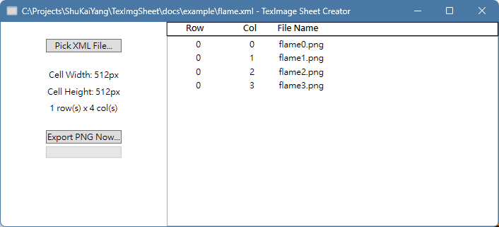

使用說明
----

用一個例子來說明，準備了以下四張圖片:

| 檔名| 圖片 | 
| --- | --- | 
| flame0.png |  | 
| flame1.png |  | 
| flame2.png |  | 
| flame3.png |  | 

接著在相同目錄下準備了一個 [flame.xml](example/flame.xml) 檔案，內容如下:

```xml
<?xml version="1.0"?>
<sheet>
  <canvas rows="1" cols="4" cellwidth="512" cellheight="512" />
  <sprites>
    
    
    
    
  </sprites>
</sheet>
```

將這個檔案拖曳到如下的本軟體畫面中，應該會看到 frame.xml 檔案中的資訊被填入，如下圖所示:



最後按下「Export PNG Now...」按鈕，獲得 frame.png 如下圖:

